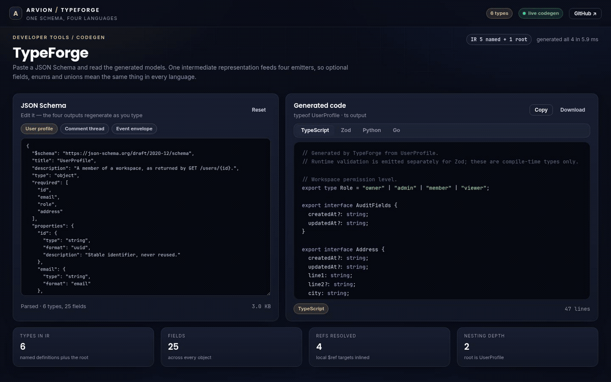
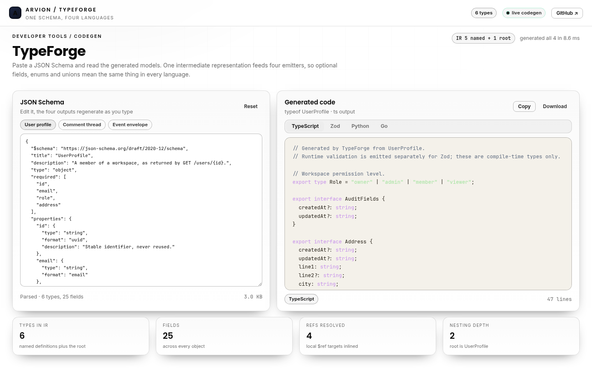
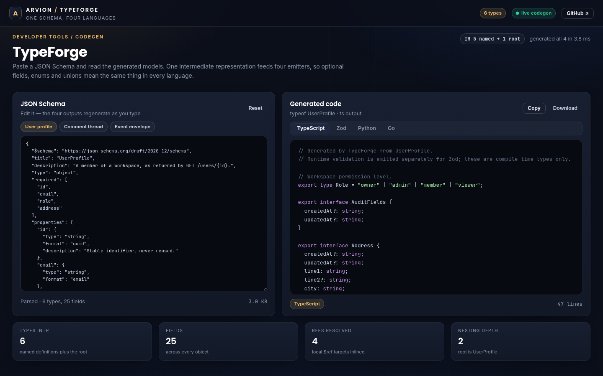

<div align="center">

</div>

<sub>Recorded from the live demo, <a href="docs/demo.mp4">MP4</a> · <a href="docs/screenshot.png">static frame</a></sub>

# TypeForge

One JSON Schema document in, four consistent sets of models out: TypeScript
interfaces, Zod validators, Python dataclasses and Go structs. No dependencies
in this repository, no build step, and a browser playground that regenerates
all four as you type.

[**Open the live demo**](https://arvion-technology.github.io/labs/demos/typeforge/) · [MIT](LICENSE)

---

Every service has a schema language and then a pile of hand-written models
per language. Hand-written models drift: someone marks a field optional in the
API and forgets the Go struct. TypeForge compiles the schema into a small
language-neutral IR once and then renders each target from that IR, so
"optional", "nullable" and "enum" mean exactly the same thing everywhere.

## What it does

- **Loads JSON Schema** draft-07 or 2020-12, including `$defs`, `definitions`
  and `components/schemas`.
- **Resolves local `$ref`s** once, keeping authored definition names rather
  than expanding copies; recursive schemas become recursive types.
- **Builds an IR** of objects, arrays, unions, intersections, enums and
  primitives, carrying property names, descriptions, defaults and constraints.
- **Emits four languages** from that single IR:
  - TypeScript interfaces and literal unions.
  - Zod validators with `.min()`, `.email()`, `.uuid()`, `.datetime()`, union
    and record support, plus `z.infer` types.
  - Python dataclasses, `Enum` classes, `Optional`, `Literal` and `Union`.
  - Go structs with json tags, pointer optionals and typed enums.
- **Flattens `allOf`** into one object when every part is object-like, so
  composed schemas do not become useless intersection types.
- **Runs in the browser and the CLI**: the same `codegen()` call powers the
  demo and `typeforge schema.json --lang go`.

## Screenshots

| TypeScript output | Python output for a recursive schema |
| --- | --- |
|  |  |

## Architecture

```text
 schema.json
     │
     ▼
 src/resolver.js     parseSchema, local $ref resolution
     │
     ▼
 src/ir.js           buildIR: one node per type, named definitions,
     │               orderedDefinitions for dependency-safe emission
     ├───────────────┬───────────────┬───────────────┐
     ▼               ▼               ▼               ▼
 emit/typescript  emit/zod       emit/python     emit/go
     │               │               │               │
     └───────────────┴───────┬───────┴───────────────┘
                             ▼
                      demo/app.js + scripts/cli.mjs
```

The IR is the contract between the front and back of the tool. An emitter is
a pure function from IR to a string; it may not read the original schema. That
restriction is why the four outputs agree on edge cases.

## Quickstart

```bash
git clone https://github.com/arvion-technology/typeforge.git
cd typeforge
npm test                                  # 35 tests, no dependencies
node scripts/cli.mjs examples/user-profile.json --lang zod
node scripts/cli.mjs examples/user-profile.json --lang go --out models.go
node scripts/cli.mjs examples/user-profile.json --all
```

The generated TypeScript and Zod files expect the consumer to have `zod`
installed; TypeForge itself has no runtime dependencies. The demo does not load
Zod, it only renders the code as text.

## How it works

**Optional and nullable are kept distinct.** A property is optional when it is
missing from the object's `required` array, and nullable when its type includes
`null` or the schema sets `nullable: true`. The four emitters express those
differently and correctly: TypeScript uses `?` and `| null`, Zod chains
`.optional()` and `.nullable()`, Python uses `= None` and `Optional[T]`, and Go
uses `omitempty` and a pointer type. Collapsing the two into one flag is the
most common bug in schema-to-code tools.

**Definitions are emitted in dependency order.** `orderedDefinitions` walks the
IR depth-first and emits a type after the types it references, so the generated
TypeScript, Python and Go read top-down without forward declarations. When a
schema is recursive, `Comment.replies: Comment[]`, the cycle is detected and
stopped; Zod wraps that reference in `z.lazy(() => CommentSchema)` so the const
can refer to itself.

**`allOf` is merged only when that is honest.** If every branch resolves to an
object, the IR merges their properties and required lists into one object. Real
composition is usually a shared `AuditFields` plus the resource's own fields,
and the flattened result is what a reviewer expects. If any branch is not an
object, the IR keeps an intersection node; TypeScript renders `A & B`, while
Python and Go fall back to a mapping or `json.RawMessage` rather than inventing
semantics their type system does not have.

**Defaults drive field order in Python.** A dataclass cannot have a field with a
default before a field without one, so the Python emitter sorts required fields
first and defaulted fields after, preserving schema order inside each group.
It also maps `format: date` and `format: date-time` to `datetime.date` and
`datetime.datetime`, and adds the imports it actually used.

## Tests

```bash
npm test
```

35 `node:test` cases across four files. The resolver suite covers pointer
escaping, ref chains and rejection of remote refs; the IR suite covers named
definitions, `allOf` flattening, `type: ["string","null"]`, recursive schemas,
unions, enums, ordering and dependency counts; the emitter suite asserts the
concrete output of all four languages against the sample schemas; the index
suite covers `codegen()` determinism, the CLI (single language, `--all`,
`--out`, unknown language) and drift between `examples/user-profile.json` and
the in-app sample.

```bash
node scripts/serve-check.mjs   # demo asset references and placeholder check
```

## Limitations

Only JSON input is accepted; YAML schemas would need another parser, and the
project chose to spend that complexity budget on the IR instead. Remote `$ref`s
are rejected. Anonymous nested objects become inline types in TypeScript and
Zod, but Python falls back to `Dict[str, Any]` and Go to
`map[string]any`, generate a named `$defs` entry when you need a real class or
struct. Intersections that are not object-shaped degrade to `json.RawMessage`
in Go. The output is checked by assertions on strings, not compiled with `tsc`,
`go build` or `python -m py_compile`, so a reviewer should compile the generated
file in the target project before trusting it. There is no `$dynamicRef`,
pattern-property or tuple support.

## Project layout

```text
typeforge/
├── src/
│   ├── resolver.js       # parse JSON Schema, resolve local $refs
│   ├── ir.js             # intermediate representation, ordering, stats
│   ├── format.js         # identifier casing, comments, HTML escaping
│   ├── index.js          # codegen() and the language registry
│   ├── emit/typescript.js
│   ├── emit/zod.js
│   ├── emit/python.js
│   ├── emit/go.js
│   └── samples.js        # the three demo schemas
├── test/                 # 35 node:test cases
├── scripts/cli.mjs       # typeforge <schema> [--lang] [--out] [--all]
├── examples/             # user-profile.json
└── demo/                 # static playground, imports ../src
```

## Credits

Built by [Arvion Technologies](https://arviontech.net) in Kathmandu as part of
our open-source [Labs](https://github.com/arvion-technology/labs) series. MIT
licensed.
